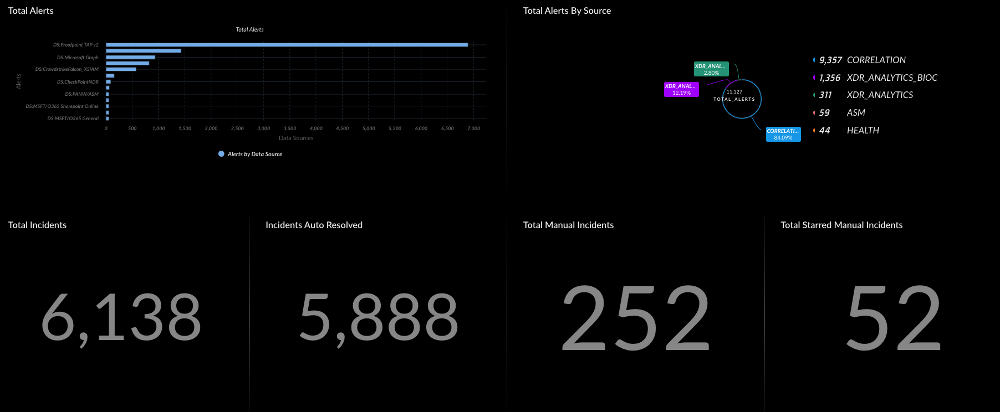
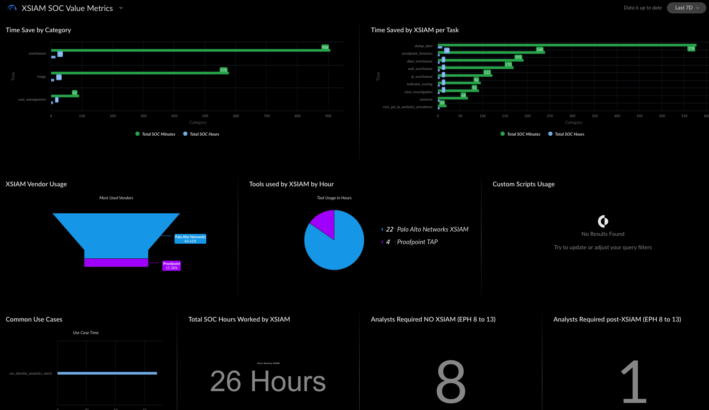

# Value Metrics Usage Guide

This guide explains how to configure and use Value Metrics to measure the time savings, automation impact, and tool utilization across your XSIAM environment.

---

## 📌 What Are Value Metrics?

The Value Metrics dashboard helps quantify automation value by capturing:

- Time saved by task and category
- Usage of scripts vs playbooks
- Vendor and product coverage
- Analyst effort avoided
- Alert-to-incident compression

---

## ⚙️ How Value Metrics Work

Value is recorded per action: the analyst minutes it saves and its category. `SOCCommandWrapper`
takes this tenant's value (`SOCFWTenantConfig` → `value`) or else the pack's (`SOCActionTimeMap_V3`)
every time an action runs, and writes both onto the row in `xsiam_socfw_ir_execution_raw`, which the
dashboard adds up. Playbook
metrics come from the JOB that stores playbook runs in `xsiam_playbookmetrics_raw`.

No lookup table and no join: the `value_tags` lookup is retired.

---

## 🛠️ Configuring Value

View and change values with [`setValueTags`](setValueTags.md):

```bash
!setValueTags action=list_all
!setValueTags action=update tag=soc-isolate-endpoint time=20
!setValueTags action=add tag=soc-star-case time=5 category=triage
```

`list_all` also names the framework actions with no value; they record 0 minutes until one is added.

## 🧩 What Value Metrics Show You

Break down automation and operational insights into actionable visual metrics:

### 🔧 Time Saved by Task
Quantifies how much effort is saved for each individual automation task:
- IP enrichment
- Proofpoint forensics
- Alert deduplication
- WHOIS lookups
- URL detonations

Use this to identify high-impact automation points.

---

### 📂 Time Saved by Category
Groups automation savings into broader operational domains:
- **Enrichment**
- **Triage**
- **Case Management**
- **Investigation**

Use this to understand where the most analyst time is being saved at a higher level.

---

### 🏷️ Vendor & Product Usage
Shows which vendors and products are being automated — and how often.

Use this to:
- Identify over/underutilized tools
- Align automation investment with license spend
- Justify tool consolidation or expansion

---

### 💡 Scripts vs Playbooks
Displays how often custom scripts are run versus supported playbooks.

Use this to:
- Identify where reusable playbooks should be created
- Reduce script sprawl and technical debt
- Promote sustainable automation patterns

---

### 🧪 Use Case Execution
Measures how often complete use case playbooks are executed:
- Phishing
- Malware
- Identity-based alerts
- Insider threat

Use this to:
- Validate coverage across threat types
- Track use case adoption and maturity

## 🧮 Analyst Effort Equivalency

Use Value Metrics to estimate how much analyst workload is being reduced through automation. This helps translate technical impact into business value.

### 🔢 How to Calculate Analyst Savings

1. **Sum the total time saved** across all tagged tasks and playbooks
2. **Convert minutes to hours** (if needed)
3. **Divide by typical analyst work hours** per month (e.g., 160 hours)
4. **Estimate effort saved** in terms of full-time analyst equivalents
5. Optionally compare against alert handling rate (e.g., 8–13 events/hour)
event-per-hour calculations, this could free up **1–2 analysts** for higher-value tasks.

Use this metric to:
- Quantify operational ROI
- Support staffing justifications
- Demonstrate outcome-based transformation

## 🔁 Alert-to-Incident Funnel

The Alert-to-Incident Funnel illustrates how automation reduces alert volume and analyst workload by filtering, grouping, and resolving alerts before they ever reach a human.

### 📉 Funnel Stages

1. **Raw Alerts Ingested**  
   Alerts received from all data sources (e.g., endpoint, network, email, cloud)

2. **↓ Auto-grouped / Suppressed**  
   Duplicate or low-value alerts are grouped or dropped automatically

3. **↓ Incident Generation**  
   Remaining meaningful alerts form incidents through correlation logic

4. **↓ Auto-Resolved Incidents**  
   Playbooks or policies resolve incidents automatically without analyst input

5. **↓ Manual Incidents Remaining**  
   Final queue of incidents that require human review or decision-making

### 🎯 Why It Matters

- Visualizes the impact of alert triage, suppression, and automation
- Highlights how many alerts are prevented from reaching analysts
- Demonstrates operational efficiency during PoV or steady-state use
- Justifies automation investment and focus policies

### 🖼️ Dashboard Example



## 🖼️ Diagram References

Use the following visual aids to support your Value Metrics documentation:

### 📊 Value Metrics Dashboard

Displays time saved by task and category, script vs. playbook usage, and vendor/product automation distribution.



### 📊 Alert Funneling Dashboard


## ✅ Best Practices

Follow these guidelines to ensure your Value Metrics setup is accurate, sustainable, and useful:

- 🔖 **Use clear and descriptive `tag` names**  
  Makes widgets and dashboards easier to read and interpret.

- 🧾 **Prefer `playbook name` over UUIDs**  
  Simplifies maintenance and reduces errors when tracking use cases.

- ⏱️ **Set realistic `minutes` values**  
  Base estimates on actual analyst workflows to ensure meaningful impact measurements.

- 🏷️ **Include `product` and `vendor` fields**  
  Enables visibility into which tools are providing automation value.

- 📊 **Review metrics regularly**  
  Catch drift in automation adoption and validate that time savings reflect actual operations.

- 🛠️ **Standardize tagging practices**  
  Use naming conventions and CI/CD processes to maintain consistency across environments.

- 🧠 **Correlate metrics to business value**  
  Use headcount equivalents and funnel drop-off visuals to tell a compelling value story.

